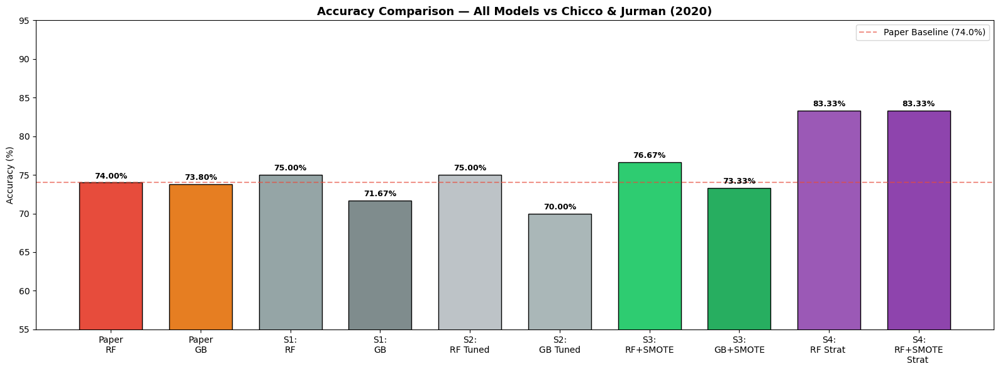

# Heart Failure Survival Prediction

Predicting death of heart failure patients from clinical records using **Random Forest** and **Gradient Boosting**, benchmarked against [Chicco & Jurman (2020)](https://doi.org/10.1186/s12911-020-1023-5).



## Overview

- **Dataset:** [Heart Failure Clinical Records](https://www.kaggle.com/datasets/andrewmvd/heart-failure-clinical-data), with 299 patients and 12 features. The target is `DEATH_EVENT`, split 68% survived and 32% died.
- **Goal:** replicate the paper's Random Forest and Gradient Boosting results, then improve on them.
- **Pipeline:**
  1. Baseline replication (80/20 split)
  2. GridSearchCV tuning
  3. SMOTE on the training set
  4. Stratified train/test split
- **Metrics:** Accuracy, F1-Score, ROC AUC and MCC, the same as the paper.

## Results

| Model | Accuracy (%) | F1 | ROC AUC | MCC |
|---|---|---|---|---|
| Paper – Random Forest | 74.00 | 0.547 | 0.800 | 0.384 |
| Paper – Gradient Boosting | 73.80 | 0.527 | 0.754 | 0.367 |
| Stage 1: RF (baseline) | 75.00 | 0.615 | 0.830 | 0.493 |
| Stage 1: GB (baseline) | 71.67 | 0.585 | 0.882 | 0.408 |
| Stage 2: RF (tuned) | 75.00 | 0.634 | 0.856 | 0.484 |
| Stage 2: GB (tuned) | 70.00 | 0.571 | 0.842 | 0.369 |
| Stage 3: RF + SMOTE | 76.67 | 0.682 | 0.873 | 0.515 |
| Stage 3: GB + SMOTE | 73.33 | 0.636 | 0.857 | 0.442 |
| Stage 4: RF (stratified) | 83.33 | 0.706 | 0.892 | 0.600 |
| **Stage 4: RF + SMOTE (stratified)** | **83.33** | **0.706** | **0.900** | **0.600** |

## Key Findings

- **Serum creatinine** and **ejection fraction** are the strongest clinical predictors, which agrees with the paper.
- **Tuning added little.** Tuned Gradient Boosting performed slightly worse than its baseline.
- **SMOTE improved both models**, reducing missed deaths (false negatives) for Random Forest from 13 to 10.
- **The best model, RF + SMOTE with a stratified split,** reached 83.33% accuracy and ROC AUC 0.900.

## Limitations

- **Single split.** Results come from one train/test split with 60 test patients, while the paper reports the mean of 100 runs.
- **The `time` feature is included.** `time` is the follow-up period, which partly depends on the outcome, so it may inflate performance.
- **Different test set in Stage 4.** The stratified split uses a different test set from Stages 1–3, so its gain is not a like-for-like comparison.

## How to Run

```bash
git clone https://github.com/Adamharith2005/heart-failure-survival-prediction.git
cd heart-failure-survival-prediction
pip install -r requirements.txt
jupyter notebook notebooks/heart_failure_group_assignment.ipynb
```

The notebook downloads the dataset automatically with `kagglehub`.

## Team

Group assignment (Predictive Modeling & Research Benchmarking) for a Data Analytics course at Universiti Malaya, by Muhammad Adam Harith bin Mohd Zaki, Nazhan Fahim bin Mohammad Najib, Amirul Hisyam bin Amir Ruddin, Iman Amirul Hakim bin Badlishah, Muaz Zikry bin Syamsul and Rauf bin Zaidi.