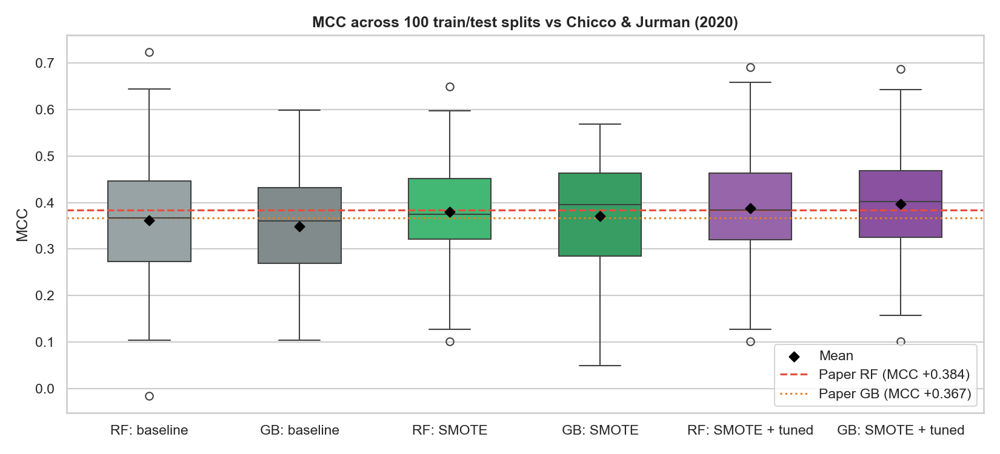

# Heart Failure Survival Prediction

Predicting death of heart failure patients from routine clinical records using **Random Forest** and **Gradient Boosting**, with a fair benchmark against [Chicco & Jurman (2020)](https://doi.org/10.1186/s12911-020-1023-5).



## Overview

- **Dataset:** [Heart Failure Clinical Records (UCI)](https://archive.ics.uci.edu/dataset/519/heart+failure+clinical+records), with 299 patients and 11 clinical features. The target is `DEATH_EVENT`, split 68% survived and 32% died.
- **Evaluation (same conditions as the paper):**
  - 100 random 80/20 splits, reported as mean ± standard deviation
  - `time` (follow-up period) excluded
  - every model evaluated on the same splits
- **Pipeline:**
  1. Baseline
  2. SMOTE, applied inside the training data only
  3. Nested hyperparameter tuning, scored on MCC
- **Metrics:** MCC (main metric), F1, Accuracy, Recall and ROC AUC.

## Results

Mean over 100 splits:

| Model | MCC | F1 | Accuracy | Recall | ROC AUC |
|---|---|---|---|---|---|
| Paper: Random Forest | 0.384 | 0.547 | 0.740 | 0.491 | 0.800 |
| Paper: Gradient Boosting | 0.367 | 0.527 | 0.738 | 0.477 | 0.754 |
| RF: baseline | 0.361 | 0.525 | 0.737 | 0.467 | 0.783 |
| GB: baseline | 0.348 | 0.528 | 0.728 | 0.489 | 0.742 |
| RF: SMOTE | 0.379 | 0.571 | 0.730 | 0.573 | 0.768 |
| GB: SMOTE | 0.370 | 0.570 | 0.723 | 0.584 | 0.746 |
| RF: SMOTE + tuned | 0.388 | 0.585 | 0.728 | 0.608 | 0.769 |
| **GB: SMOTE + tuned** | **0.397** | **0.593** | 0.730 | **0.627** | 0.758 |

## Key Findings

- **The paper's results were reproduced.** Both baselines fall within one standard deviation of the published results on every metric.
- **The best model, Gradient Boosting with SMOTE + tuning, beats the paper on MCC, F1 and recall** (0.397, 0.593 and 0.627), but not on accuracy or ROC AUC.
- **The gains come from handling class imbalance.** Over its own baseline on the same 100 splits, the best model improves:
  - recall by +0.14 (p < 0.001)
  - MCC by +0.049 (p < 0.001, better in 66 of 100 splits)
- **Serum creatinine and ejection fraction** are the strongest predictors, which agrees with the paper.
- **Including `time` inflates accuracy from about 74% to 84%.** This is target leakage, because follow-up ends when a patient dies. It also explains the original version's single-split result of "83% accuracy" (see [`archive/`](archive/)).

## Limitations

- **Cross-study comparison.** The paper used R and its own random splits, so small differences against the paper should not be over-interpreted. The paired improvement over this study's own baseline is the more reliable result.
- **Small, single-hospital dataset.** It has 299 patients from one hospital, recorded in 2015, and there is no external validation.
- **Fixed decision threshold of 0.5.** Adjusting the threshold could trade false alarms for missed deaths further.

## How to Run

```bash
git clone https://github.com/Adamharith2005/heart-failure-survival-prediction.git
cd heart-failure-survival-prediction
pip install -r requirements.txt
jupyter notebook notebooks/heart_failure_survival_prediction.ipynb
```

## About

This is an extended version of a group assignment for a Data Analytics course at Universiti Malaya. The original version was built by Muhammad Adam Harith bin Mohd Zaki, Nazhan Fahim bin Mohammad Najib, Amirul Hisyam bin Amir Ruddin, Iman Amirul Hakim bin Badlishah, Muaz Zikry bin Syamsul and Rauf bin Zaidi. I reworked the evaluation into a fair, repeated-split benchmark. The original submission is kept in [`archive/`](archive/) for comparison.